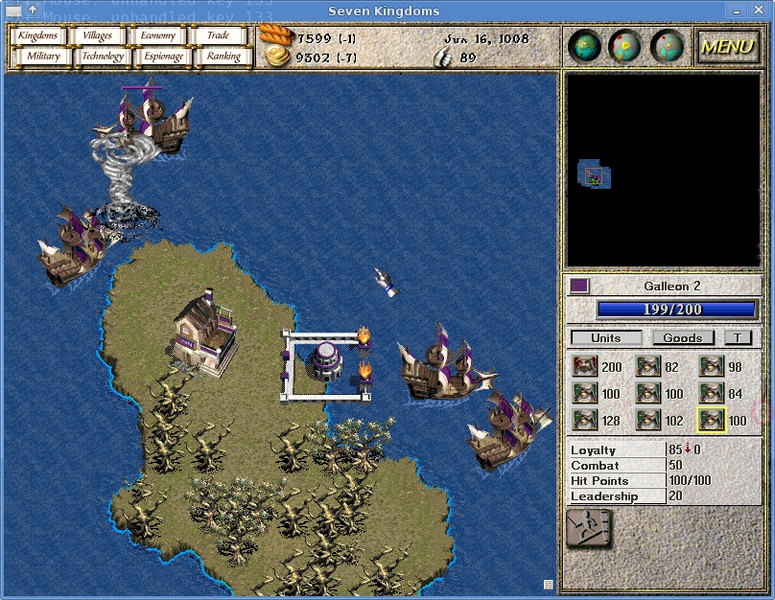
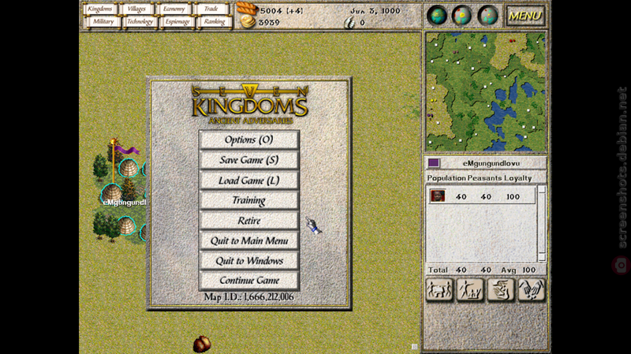

# Seven Kingdoms: Ancient Adversaries for Android



A native Android port of **Seven Kingdoms: Ancient Adversaries**, Trevor Chan's 1997 real-time strategy
game of trade, diplomacy, espionage and war. It is built from the official **7kfans 2.15.7 GPL source**:
the original engine and AI, compiled for arm64 phones, with touch controls added. It is not a remake or an
emulator.

> Unofficial community port. Not affiliated with or endorsed by 7kfans, Enlight Software or the original
> authors. Please support the [7kfans project](https://7kfans.com/), which keeps the game alive.

## Download and install

1. Download `SevenKingdoms-*.apk` from the [latest release](../../releases/latest).
2. Open it on your phone. Android asks you to allow **Install unknown apps** for your browser or file
   manager; allow it, then tap **Install**. Play Protect may warn that it doesn't recognise the developer;
   choose **Install anyway**.
3. First launch takes 10 to 30 seconds on a black screen while the game data (about 150 MB) is copied to
   the phone. Later launches are instant.

Requirements: Android 7.0 (API 24) or newer, a 64-bit ARM phone (`arm64-v8a`; almost every phone since
2017), about 400 MB of free space.

Updates install over the previous version and keep your saved games.

## Controls

The game is played with your fingers. The original mouse cursor is hidden, and every tap lands exactly
where you touch.

| Gesture | Action |
|---|---|
| Tap | Select / click |
| Long-press (hold about 0.4 s; a ring grows) | Right click: move, attack, assign |
| Two-finger tap | Right click at the midpoint |
| One-finger drag | Box-select units |
| Two-finger drag | Scroll the map |
| Back | In-game menu (Esc) |

**Toolbar.** The game is 4:3, so on a phone it has black bars on both sides. The right-hand bar holds
buttons for keys that have no mouse equivalent: **Pause**, **Slower**, **Faster**, **K** (jump to your
king), **G** (jump to your general) and **D** (open the oldest diplomatic message). On a 4:3 tablet the
toolbar is a strip that opens from a handle in the top-left corner.

**Cheats.** Tap **C** on the toolbar to open the cheats panel in the left-hand bar. Switch **Cheats ON**
(it types the game's own Shift + `111 222 333` code, then tap away the game's "Cheat Mode Enabled" message)
and the buttons unlock:

| Button | Effect |
|---|---|
| CASH +1000 / FOOD +1000 | +1000 money / +1000 food |
| ALL TECH AND GODS | All technologies and Greater Beings |
| REVEAL MAP | Reveal the whole map |
| IMMORTAL KING | Toggle: your king cannot die |
| FAST BUILD | Toggle: buildings finish almost instantly |
| TOWN POP +10 | Ten more people in the selected town |
| PRAYER MAX | Fill the selected Seat of Power |
| FIRM FULL HP | Selected building to full hit points |
| COMBAT +20 / SKILL +20 / SPY SKILL +20 | Raise the selected unit's combat, skill or spying level |

These are exactly the cheats built into the game (full reference: [docs/CHEATS.md](docs/CHEATS.md)). They
work in single player only, and the game marks a cheated game "(Cheated)" on its final score. Switching
the panel OFF locks the buttons; the game itself has no way to turn cheat mode off for that game.

**Leaving the app.** Switching away (Home, a call, screen off) pauses the game and the music. When you come
back the game is still paused: tap **Pause** to carry on. The game's own autosave runs every two in-game
months; save manually before closing the app if you want to keep your exact position.



## What's different from the PC version

- Single player only. Online/LAN multiplayer is disabled: upstream supports multiplayer on x86 only, and an
  ARM build would fall out of sync with PC players.
- English only.
- Runs fullscreen with the system bars hidden (swipe from an edge to show them briefly).
- Long-press the app icon and choose **Licences** to read the game and music licences.

## Building from source

| Tool | Version |
|---|---|
| Android SDK | platform `android-36`, build-tools `36.0.0` |
| Android NDK | `27.1.12297006` |
| CMake (from the SDK) | `3.22.1` |
| JDK | 21 (Gradle 8.14.3, AGP 8.11.0) |
| Host tools | `curl`, `shasum`, `rsync`, `patch`; `sips` (macOS) for the icon; `keytool`, `openssl` for signing |

```sh
scripts/fetch-deps.sh          # download the pinned sources in third_party/VERSIONS.md, verify sha256
scripts/build.sh               # debug APK  -> android/app/build/outputs/apk/debug/app-debug.apk
scripts/build.sh release       # signed APK -> android/app/build/outputs/apk/release/app-release.apk
```

`build.sh` copies the pristine game source to `build/`, applies `patches/7kaa/*.patch`, stages the game
data and music as APK assets, and runs Gradle. Upstream sources under `third_party/` are never edited.

Release signing uses a keystore kept outside the repository (`~/.android/7kaa-release.jks` plus
`~/.android/7kaa-release.properties`); `build.sh release` creates one if neither exists. A build signed
with a different key cannot update an installed copy.

### How the port works

| Part | What it does |
|---|---|
| `patches/7kaa/0001` | SDL entry point; copy game data from the APK to internal storage on first launch |
| `patches/7kaa/0002`, `0007` | Video: fixed 32-bit texture format, rebuild after GPU context loss, letterboxing done by the game so touch coordinates stay exact |
| `patches/7kaa/0003` | `glob()` replacement (Android's libc only has it from API 28) |
| `patches/7kaa/0004` | Touch input layer and toolbar (`port/android/sk_touch.cpp`) |
| `patches/7kaa/0005` | Pause game and audio in the background (`port/android/sk_lifecycle.cpp`) |
| `patches/7kaa/0006` | Hide the game's software cursor |
| `patches/7kaa/0008` | Cheats panel game-state hook (`port/android/sk_cheats.cpp`) |
| `port/CMakeLists.txt` | Builds SDL2, openal-soft (OpenSL ES backend), enet and the game as `libmain.so` |
| `android/` | Gradle project, activity (fullscreen, keep screen on), Licences screen |

Every change to the game source is behind `#ifdef __ANDROID__`. `docs/AUDIT.md` is the portability audit
of the upstream code, and `docs/CONTRACT.md` is the build specification the port follows.

## Licences and credits

- **Seven Kingdoms: Ancient Adversaries** was created by Trevor Chan and Enlight Software, released under the
  GNU GPL v2 in 2009, and is maintained by the [7kfans](https://7kfans.com/) community
  ([source](https://sourceforge.net/projects/skfans/)).
- **This port** (`patches/`, `port/`, `android/`, `scripts/`) is GPL v2 as well; see [LICENSE](LICENSE).
- **Music** © 1997 Bjørn Lynne and Enlight Software Ltd. It is not GPL. Its notice allows free
  redistribution for use with Seven Kingdoms, provided the set is complete and unmodified, the authors are
  credited and the notice is kept. The APK ships all 10 tracks unmodified with `COPYING-Music.txt`.
- **Libraries:** [SDL 2](https://www.libsdl.org/) (zlib), [openal-soft](https://openal-soft.org/)
  (LGPL-2.0, dynamically linked), [enet](http://enet.bespin.org/) (MIT). Versions and checksums are in
  `third_party/VERSIONS.md`.
- **Screenshots** above are from the game's official [Flathub listing](https://flathub.org/apps/com.sevenkfans.sevenkaa)
  (PC version).
